# Arduino VENTUNO Q Mecanum Rover /IOTCONNECT Demo

A four-wheel mecanum rover driven from [Avnet /IOTCONNECT](https://www.iotconnect.io/), built on the
**Arduino VENTUNO Q** and the **Adafruit Motor/Stepper/Servo Shield for Arduino**.
The VENTUNO Q has two processors, and the demo uses both.
The Linux side (Qualcomm Dragonwing IQ8) runs a Python app that connects to /IOTCONNECT with the
[/IOTCONNECT Python Lite SDK](https://github.com/avnet-iotconnect/iotc-python-lite-sdk) and receives commands.
The STM32 microcontroller runs an Arduino sketch that drives the four motors through the motor shield.
The two talk over Arduino's Bridge.

Each wheel has its own motor channel, so the rover drives forward and backward, strafes sideways,
moves diagonally and rotates in place, from movement commands sent by a web dashboard
(or the /IOTCONNECT console). Every move runs for a set time and then stops.
The rover publishes its status (motor shield health, last command, uptime, wheel trim) to
/IOTCONNECT every 10 seconds.

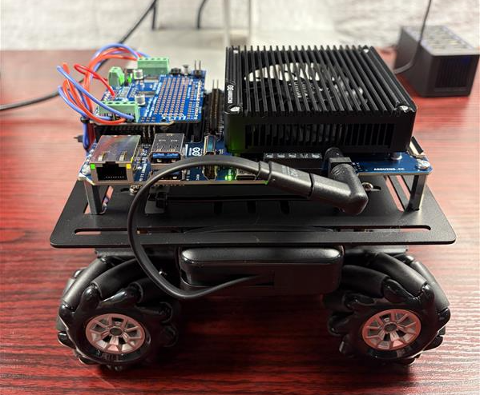

## Table of Contents

1. [Prerequisites](#1-prerequisites)
2. [Get the Demo Source](#2-get-the-demo-source)
3. [Cloud Account Setup](#3-cloud-account-setup)
4. [Import the Device Template](#4-import-the-device-template)
5. [Board First-Time Setup](#5-board-first-time-setup)
6. [Generate the Device Certificate](#6-generate-the-device-certificate)
7. [Create the Device in /IOTCONNECT](#7-create-the-device-in-iotconnect)
8. [Assembling the Rover](#8-assembling-the-rover)
9. [Install the Rover App](#9-install-the-rover-app)
10. [Run the Demo](#10-run-the-demo)
11. [Resources](#11-resources)

## 1. Prerequisites

### Hardware

1. [Arduino VENTUNO Q (ABX00181)](https://store.arduino.cc/products/ventuno-q)
2. [Adafruit Motor/Stepper/Servo Shield for Arduino](https://www.adafruit.com/product/1438)
3. [LewanSoul Mecanum Wheel Chassis Car Kit](https://www.amazon.com/dp/B093WDD9N5)
4. USB-C PD power supply of 60W or more, such as a laptop charger
5. USB-C to USB-C cable rated for 60W (3A)
6. Monitor and HDMI cable
7. USB keyboard and mouse
8. A Wi-Fi network

### Tools and Materials

1. Soldering iron and solder
2. Heat-shrink tubing or electrical tape
3. Phillips screwdriver
4. Small flathead screwdriver
5. Zip ties
6. Small pliers
7. Wire strippers and cutters
8. 22 AWG stranded electronics wire

### Recommended Mounting Hardware

The board mounts to the chassis on standoffs, which come with neither the board nor the chassis:

- 4 M3 standoffs, about 20 mm long, with M3 screws and nuts

### Mobile Power (Optional)

To drive the rover around without a power cord, power it from a USB-C PD power bank instead:

- [Anker 20,000mAh 87W Power Bank](https://www.amazon.com/dp/B0CXDXP8VR)

### Software

1. **Linux/macOS:** `ssh`, `scp` and `tar`, which come with the OS
2. **Windows 10/11:** PowerShell 5.1+, plus the OpenSSH client and `tar`, which come with Windows

> [!NOTE]
> The VENTUNO Q only powers up from a USB-C PD supply of 9V or more, the barrel jack (12-24V) or the
> screw terminal (7-24V). A PC's USB-C port or a plain 5V USB charger won't start it,
> and the board's red fault LED blinks instead.

## 2. Get the Demo Source

Download [ventuno-q-rover.zip](https://avnetpublicaccess.s3.us-east-1.amazonaws.com/ventuno-q-rover.zip) and extract it.

The commands in this guide are run from the extracted `ventuno-q-rover` folder.

On Windows, PowerShell blocks scripts downloaded from the internet by default.
Allow them for the current PowerShell window with:

```powershell
Set-ExecutionPolicy -Scope Process -ExecutionPolicy Bypass
```

## 3. Cloud Account Setup

An /IOTCONNECT account with an **AWS backend** is required. If you need to create an account, a
**free trial subscription** is available — no credit card required:

- Sign
  up: [https://subscription.iotconnect.io/subscribe?cloud=aws](https://subscription.iotconnect.io/subscribe?cloud=aws)
  (see
  the [AWS Marketplace option](https://github.com/avnet-iotconnect/avnet-iotconnect.github.io/blob/main/documentation/iotconnect/subscription/iotconnect_aws_marketplace.md)
  if you prefer)
- Log in: [https://console.iotconnect.io/login](https://console.iotconnect.io/login)

> [!NOTE]
> Be sure to check your SPAM folder for the temporary password after registering if you don't see
> it after a couple of minutes.

## 4. Import the Device Template

The template defines the rover's telemetry and its movement commands.

1. Log in at [console.iotconnect.io](https://console.iotconnect.io).
2. Open the **Device** module:

   

3. At the bottom of the page, click **Templates**:

   

4. Click **Create Template**:

   

5. Click **Import**, and select
   [`templates/ventuno-rover-template.json`](templates/ventuno-rover-template.json):

   

## 5. Board First-Time Setup

The board's first-time setup runs on its own desktop, so it needs a monitor, keyboard and mouse.

1. Connect the monitor to the board's HDMI port, and the keyboard and mouse to its two USB-A ports.
2. Power the board from the USB-C PD power supply. The first boot takes about 20-30 seconds.
3. Arduino App Lab opens on the desktop. Follow its prompts to name the board (the default is `arduino`),
   set the password of the board's `arduino` user, and connect the board to your Wi-Fi network.
   You'll use the name and password in later steps.
4. Open a terminal on your board and use the command `ip a` to see the IP address. Note this address as
   it will be needed later.

The monitor, keyboard and mouse can then come off. The board reconnects to Wi-Fi after every power-up.

## 6. Generate the Device Certificate

The rover authenticates to /IOTCONNECT with its own certificate.
This step creates the certificate and its private key on the board itself, so the key never leaves the
rover, and prints the certificate for the next step.

Replace `MYUNIQUEID` with a Unique ID of your own choosing for this device, e.g. `my-rover`.
It can contain letters, numbers and hyphens. You'll reuse it when creating the device in /IOTCONNECT.
Replace `arduino.local` with your board's name or IP address if it's different, and enter the board's
password when asked.

**Linux/macOS:**
```bash
bash tools/setup_rover.sh cert --duid MYUNIQUEID --board arduino.local
```

**Windows (PowerShell):**
```powershell
.\tools\setup_rover.ps1 cert -Duid MYUNIQUEID -Board arduino.local
```

The script prints the device certificate, from `-----BEGIN CERTIFICATE-----` to `-----END CERTIFICATE-----`.
Running it again prints the same certificate instead of creating a new one.

## 7. Create the Device in /IOTCONNECT

1. In the /IOTCONNECT console, go to the **Device** page and click **Create Device**:

   

2. Set the Unique ID and Device Name:

   

   - **Unique ID**: the **exact same** `MYUNIQUEID` value you passed to the script in Step 6
   - **Device Name**: a display name for the /IOTCONNECT console, which can use spaces

3. Select your **Entity**:

   

4. Select the `vqrover` template you imported in [Step 4](#4-import-the-device-template):

   

5. Under **Device Certificate**, choose **Use my certificate**, and paste the certificate the script printed,
   including the `BEGIN` and `END` lines:

   

6. Click **Save & View**.
7. On the device page, click the paper-and-cog icon above **Connection Info** to download the device
   configuration file, and save it as `iotcDeviceConfig.json` in the `ventuno-q-rover` folder:

   

## 8. Assembling the Rover

Follow
[this assembly guide video](https://www.amazon.com/live/video/0834f4dc06c44533a88f57900d84450c?ref_=cm_sw_cp_r_ib_dt_UfI0sVFk76dT1)
to build the chassis.

The **front** of the rover is the end the VENTUNO Q's heatsink and fan face once the board is mounted.
The wheels are named from that end as front-left (FL), front-right (FR), rear-left (RL) and rear-right (RR).

### Wheel Orientation

The kit has two mirror-image types of mecanum wheel, with their rollers angled in opposite directions.
FL and RR are one type, and FR and RL are the other.
Seen from above, the rollers on top of each wheel point toward the center of the rover, forming an X.
The rollers on the bottom of the wheels, touching the ground, form the opposite pattern.
Match your wheels to these photos:

<table>
  <tr>
    <td align="center">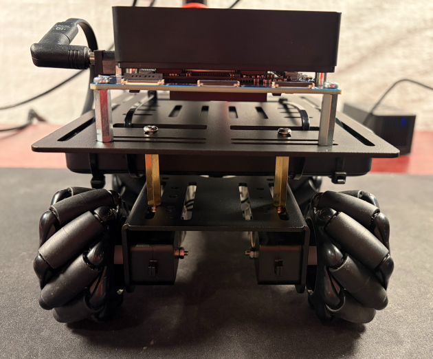<br>Front, with FR on the left and FL on the right</td>
    <td align="center">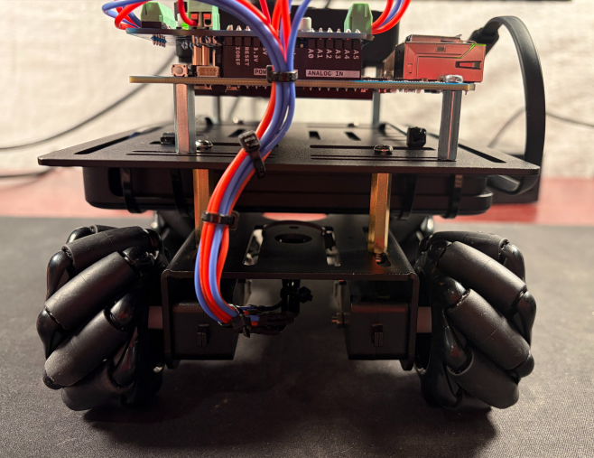<br>Rear, with RL on the left and RR on the right</td>
  </tr>
</table>

### Motor Shield Headers

The shield ships with its header pins loose. Solder them on by following Adafruit's
[header installation guide](https://learn.adafruit.com/adafruit-motor-shield-v2-for-arduino/install-headers).

> [!IMPORTANT]
> Leave the shield's power jumper cap **off**. The jumper connects the motor supply to the board's
> VIN pin, and the motors get their power from a separate wire instead (see [Motor Power](#motor-power)).

### Board Mounting

Screw an M3 standoff into each of the board's four corner mounting holes.

Set the board on the top plate with the heatsink and fan facing the front, and the UNO headers toward the rear.
The two front standoffs and the rear-left standoff line up with gaps in the top plate.
Fasten those three to the plate with M3 screws and nuts through the gaps. The rear-right standoff doesn't
line up with a gap, and rests on the plate for support.

<table>
  <tr>
    <td align="center">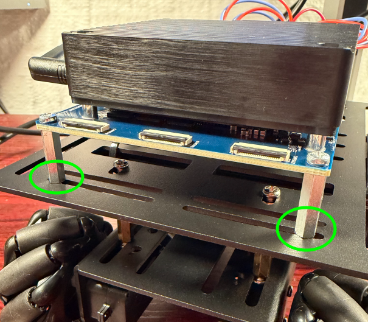<br>Front standoffs, both fastened</td>
    <td align="center">
      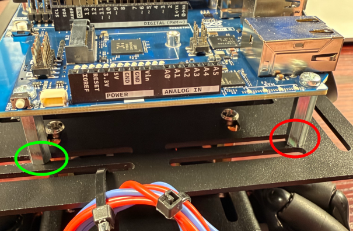<br>Rear standoffs, left fastened (green), right resting (red)
    </td>
  </tr>
</table>

> [!IMPORTANT]
> The chassis is aluminum, which conducts electricity. The standoffs keep the pins and solder joints on the
> underside of the VENTUNO Q off the top plate and its screw heads, so mount all four.
> Without standoffs, put a sheet of insulating material, such as cardboard, between the board and the
> top plate, and hold the board down with zip ties through the chassis slots.

Plug the motor shield onto the board's UNO headers.

### Motor Wiring

Each motor gets its own channel on the shield:

| Motor | Shield terminal |
|---|---|
| Front-left (FL) | **M4** |
| Front-right (FR) | **M2** |
| Rear-left (RL) | **M3** |
| Rear-right (RR) | **M1** |

```
            FRONT
   FL (M4)          (M2) FR
        \           /
          \       /
            \   /
              X
            /   \
          /       \
        /           \
   RL (M3)          (M1) RR
            REAR
```

The shield has two 5-position motor terminal blocks, **M1, M1, GND, M2, M2** on one side and
**M3, M3, GND, M4, M4** on the other. The center **GND** screw on each block stays empty.
It's only used by stepper motors.

The motor leads are too short to reach the shield on the top plate, so each one needs an extension.
For each motor:

1. Cut the connector off the motor's two leads.
2. Cut two 22 AWG stranded extension wires long enough to reach from the motor, up past the edge of the
   top plate, to the shield's terminal blocks, with a few centimeters of slack.
3. Strip about 1 cm from each lead and each extension wire, twist each lead together with one extension
   wire, and solder.
4. **Insulate both joints** with heat-shrink tubing or electrical tape.
   A bare joint touching the aluminum chassis or another joint will short the motor output.
5. Label both extension wires with the motor's name (FL, FR, RL or RR) on a piece of tape near the end,
   so you know which pair of wires belongs to which motor.
6. Strip about 5 mm from the end of each extension wire, twist the strands, and clamp the two wires under
   the two screws of the motor's channel, using the small flathead screwdriver.
   Give each wire a gentle tug.

<table>
  <tr>
    <td align="center">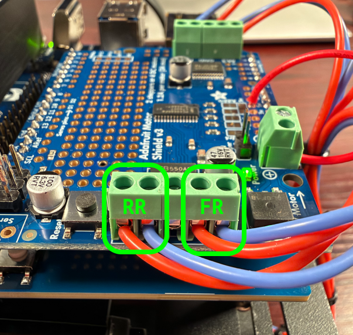<br>M1 (RR) and M2 (FR)</td>
    <td align="center">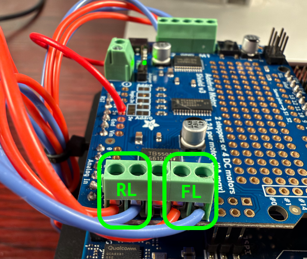<br>M3 (RL) and M4 (FL)</td>
  </tr>
</table>

Which of a motor's two wires goes to which screw doesn't matter at this point. It only sets the direction
the wheel spins, which the direction test in [Step 10](#wheel-direction-test) checks.

### Motor Power

The shield takes motor power only from its 2-position power terminal block, marked **+** and **−**.
The motors run from the VENTUNO Q's 5V supply through one wire:

1. Find the shield's **5V** pin on its power header, and the unused hole labeled **5v** just above it.
2. Solder one end of a short 22 AWG wire into that unused 5v hole.
3. Clamp the other end under the power terminal's **+** screw.

The **−** screw is already connected to ground on the shield, so it needs no wire.

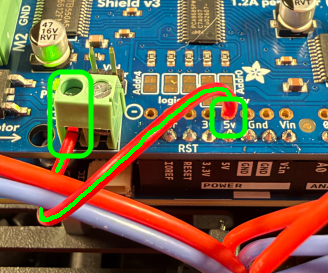

Once the board is powered, the shield's green **Power** LED lights:

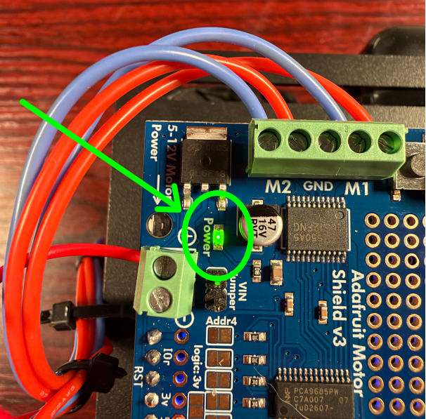

The board's 5V supply is limited to 2.8A. The rover app ramps the motors up over 200 ms so that
four motors starting together stay under that limit.

### Mobile Power (Optional)

To use the power bank, turn it sideways and fasten it in the middle "cargo" section of the chassis,
below the top plate, with zip ties. Run a USB-C to USB-C cable from the power bank's USB-C port up to the
board's USB-C port.

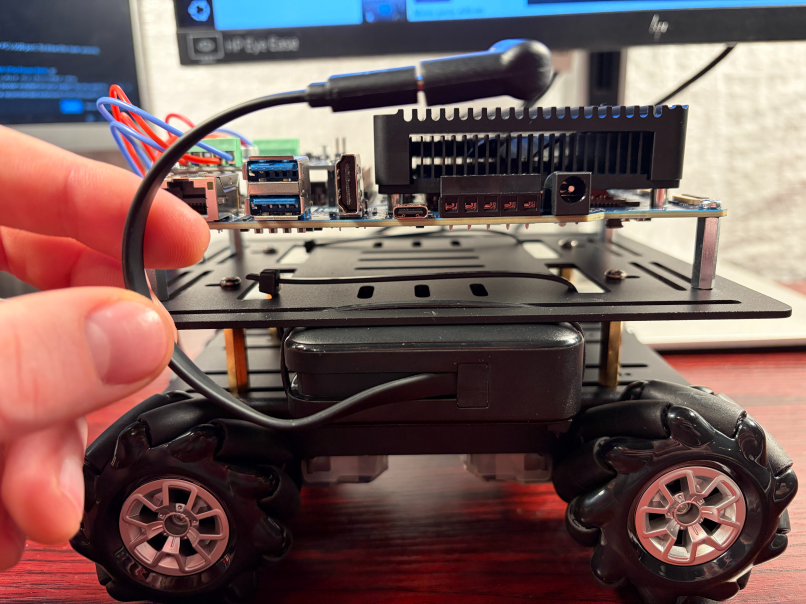

> [!NOTE]
> When you first connect the board, the power bank may not start supplying power on its own.
> Press the power bank's button once to wake it and boot the board.
> The board draws enough current to keep the power bank on after that.

### Cable Management

Use zip ties to bundle the motor leads and extension wires against the chassis,
as shown below, and route them well clear of the wheels and their rollers.
A wire caught in a mecanum wheel's rollers can stall the motor or pull a joint apart.

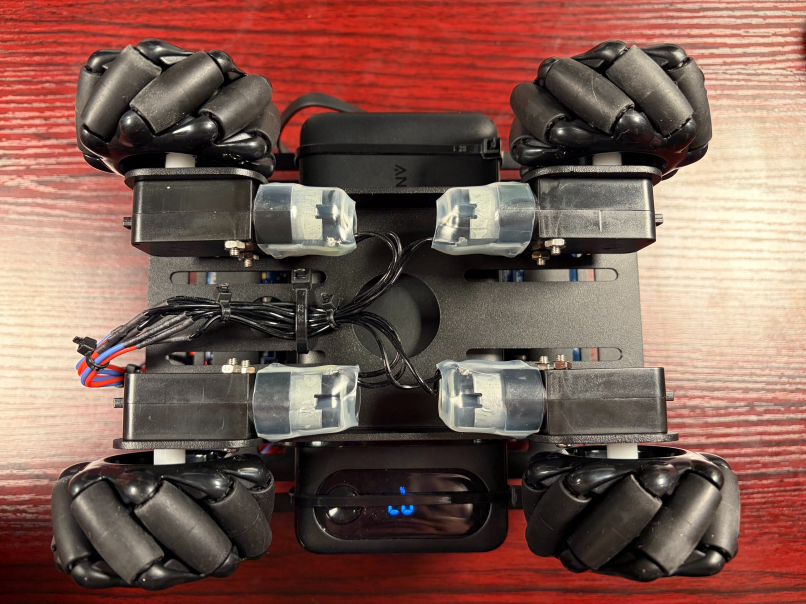

## 9. Install the Rover App

With the board powered and on Wi-Fi, run the setup script.
It copies the rover app and `iotcDeviceConfig.json` to the board, builds the app and starts it.
It also sets the app to start whenever the board boots.

Replace `arduino.local` with your board's name or IP address if it's different.
Enter the board's password when asked. The script asks for it twice.

**Linux/macOS:**
```bash
bash tools/setup_rover.sh install --config iotcDeviceConfig.json --board arduino.local
```

**Windows (PowerShell):**
```powershell
.\tools\setup_rover.ps1 install -Config iotcDeviceConfig.json -Board arduino.local
```

The first build takes a few minutes. When it finishes, the script prints the rover's first log lines:

```
Building and starting the rover app. The first build takes a few minutes...
The rover app starts by itself whenever the board boots.

[main] motor shield: shield ok, duty 0 0 0 0
[main] /IOTCONNECT connected
```

If it prints `no motor shield` instead, check that the shield sits fully on the board's headers.

> [!TIP]
> To update the rover app later, run the same command again.

## 10. Run the Demo

The rover app starts running as soon as the setup script finishes, and starts again by itself every time
the board boots.

To drive the rover without a power cord, move the board's USB-C cable from the power supply to the
power bank. The board restarts, and the rover app starts by itself about a minute later.

The rover publishes its status every 10 seconds, which you can watch on the device's **Live Data** tab
in the /IOTCONNECT console:

```json
{"drv": 1, "cmd": "forward 50 1000", "up": 754, "tfl": 100, "tfr": 100, "trl": 100, "trr": 100}
```

| Field | Meaning |
|---|---|
| `drv` | Motor shield status (`0` not found, `1` OK) |
| `cmd` | The last command the rover accepted |
| `up` | Seconds since the rover app started. Dropping back to 0 means it restarted |
| `tfl` / `tfr` / `trl` / `trr` | Speed trim (%) of each wheel, see [Calibration](#calibration) |

### Web Dashboard

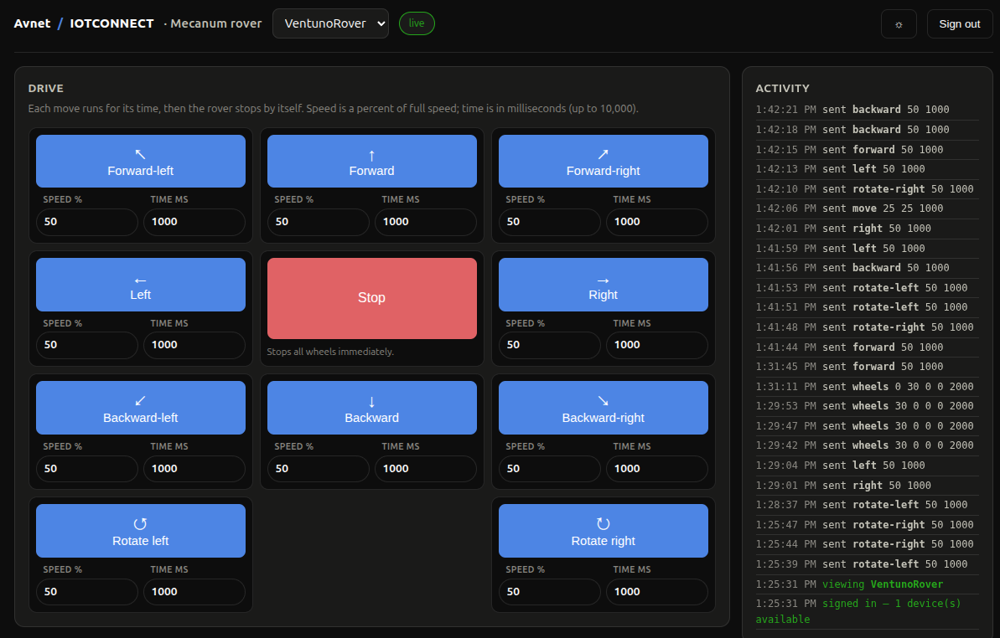

<!-- Link placeholder: the hosted dashboard URL, once it's deployed -->
You can use this AWS-hosted dashboard to drive the rover. Open
[the dashboard](HOSTED_DASHBOARD_URL) and
sign in with your own /IOTCONNECT solution key, environment, email and password.

The dashboard has three panels:

- The **Drive** panel has a button for each direction (forward, backward, left, right, the four
  diagonals and rotating left and right) with labeled **Speed %** and **Time ms** fields underneath
  each one, plus **Stop**. Each move runs for its time and then stops by itself.
- The **Advanced** panel exposes `move` (any mix of forward and sideways speed), `drive` (forward,
  sideways and rotation together), `wheels` (each wheel's speed directly) and `trim`.
- The **Activity** log lists every command sent.

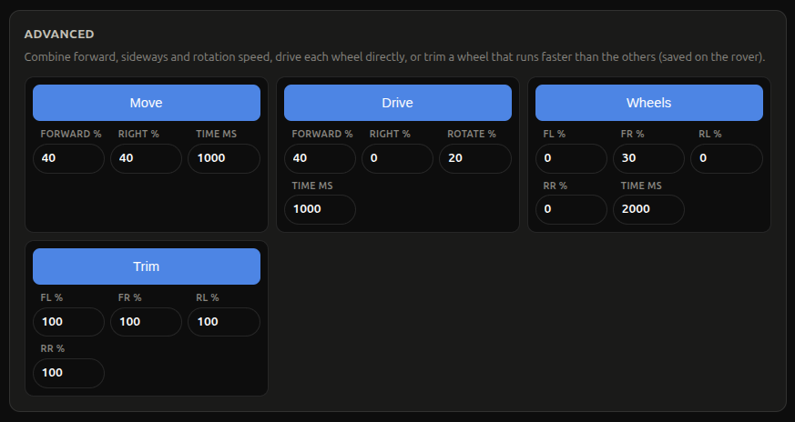

> [!NOTE]
> This dashboard is already deployed and hosted, so you don't need an AWS account to use it.
> To host your own copy, see [dashboard/README.md](dashboard/README.md).
> The same commands can also be sent from the device's **Commands** tab in the /IOTCONNECT console.
> See [DEVELOPER.md](DEVELOPER.md#rover-commands) for the full command reference.

### Sending Commands

The dashboard's buttons send the common moves. Any command, such as `wheels 30 0 0 0 2000`, can also
be sent from the device's **Commands** tab in the /IOTCONNECT console. Select the command (`wheels`),
enter the rest (`30 0 0 0 2000`) as its parameter, and click **Execute Command**.
The dashboard's **Advanced** panel has the same `wheels`, `drive` and `trim` commands with a field
for each value.

### Wheel Direction Test

Set the rover on a box or cup so its wheels spin freely, then send each of these.
Every one should spin a single wheel **forward** for 2 seconds:

| Command | Wheel |
|---|---|
| `wheels 30 0 0 0 2000` | front-left |
| `wheels 0 30 0 0 2000` | front-right |
| `wheels 0 0 30 0 2000` | rear-left |
| `wheels 0 0 0 30 2000` | rear-right |

- **The wrong wheel spins:** that motor is on the wrong channel. Check it against the table in
  [Motor Wiring](#motor-wiring).
- **The right wheel spins backward:** swap that motor's two wires on its terminal block.

Then put the rover on the floor and try `forward 40`, `right 40`, `move 25 25` (diagonal)
and `rotate-right 40`.

- **`right 40` moves the rover left:** all four wheels are on the wrong corners.
  Swap FL with FR and RL with RR. See [Wheel Orientation](#wheel-orientation).
- **`right 40` turns the rover, barely moves it or makes it shudder:** two of the wheels are on the wrong corners.
  Check each wheel against [Wheel Orientation](#wheel-orientation).

> [!TIP]
> Mecanum wheels need grip. Run the demo on concrete, a rubber mat or low carpet.
> On a smooth table or glossy floor the rollers slip and strafing drifts.

### Calibration

Some rovers drift because one wheel runs faster than the others.
`trim FL FR RL RR` sets each wheel's speed as a percent (50-100) of what a move asks for.
On a good surface, send `forward 50 2000`, `left 50 2000` and `right 50 2000` and watch the drift:

- **Curves right going forward:** the left wheels are stronger. Lower FL and RL in steps of about 5,
  starting with `trim 95 100 95 100`. Curving left is the opposite.
- **Drifts forward going left and backward going right:** the front-right and rear-left wheels are stronger.
  Lower FR and RL, starting with `trim 100 95 95 100`. The opposite drift means lowering FL and RR.

Repeat until the rover drives and strafes straight. The rover saves the trim and keeps it after a restart.
Send `trim 100 100 100 100` to clear it.

## 11. Resources

- [DEVELOPER.md](DEVELOPER.md), covering the app's architecture, the full command and telemetry reference,
  and how to change the wheel layout. Not needed just to run the demo.
- [dashboard/README.md](dashboard/README.md), the web dashboard's own documentation (architecture, deployment)
  for whoever maintains or hosts it. Not needed just to use it.
- [Arduino VENTUNO Q](https://store.arduino.cc/products/ventuno-q) and
  [Arduino App Lab](https://docs.arduino.cc/software/app-lab/)
- [Adafruit Motor Shield V2 guide](https://learn.adafruit.com/adafruit-motor-shield-v2-for-arduino)
- [/IOTCONNECT Python Lite SDK](https://github.com/avnet-iotconnect/iotc-python-lite-sdk)
- [iotc-mchp-dspic33](https://github.com/avnet-iotconnect/iotc-mchp-dspic33) (same rover chassis driven by
  a Microchip dsPIC33AK Curiosity board)
